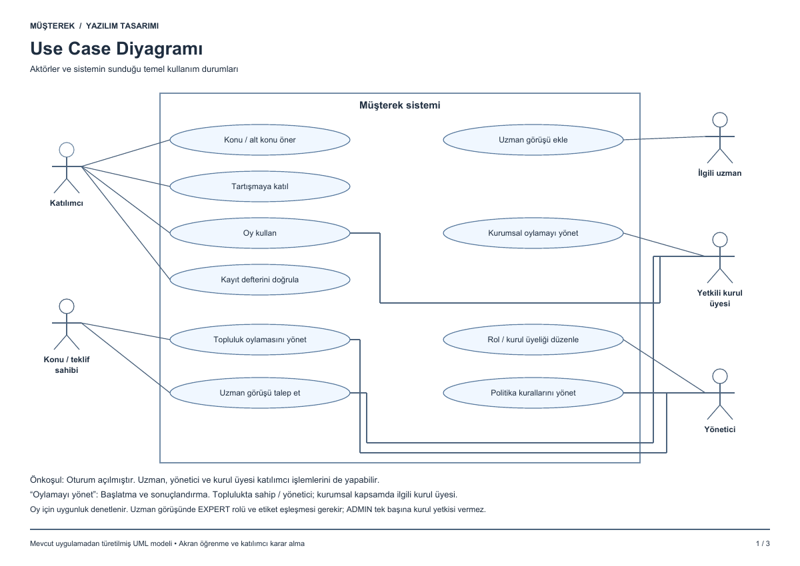
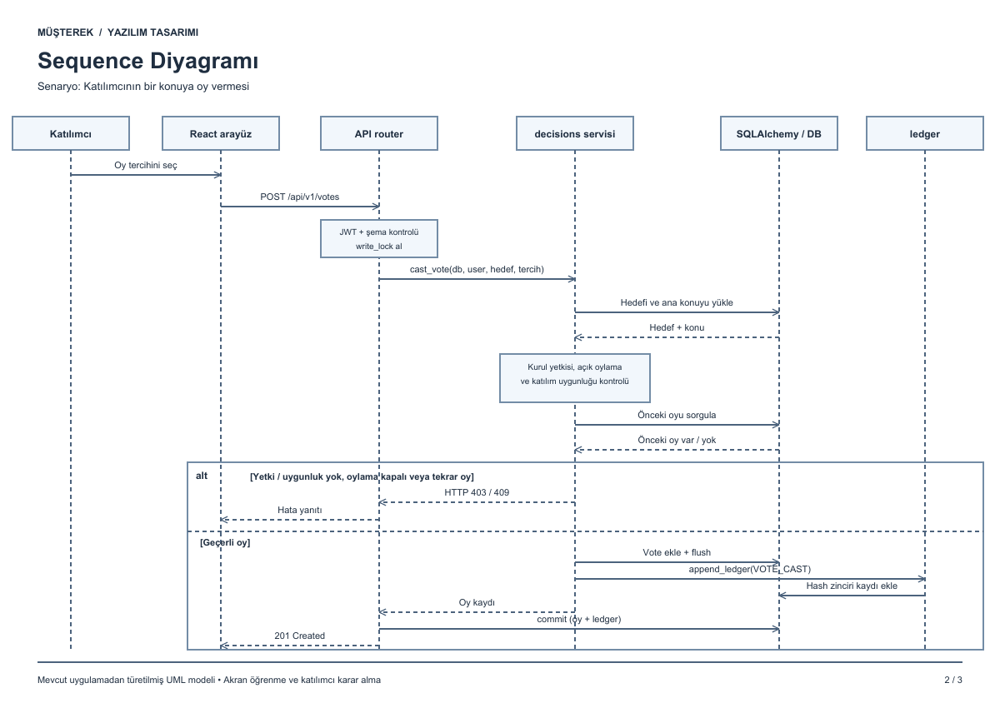
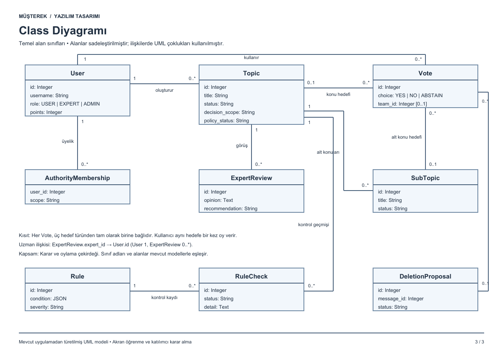

# Müşterek UML diyagramları

[Üç sayfalık PDF dosyasını aç](Musterek_UML_Diyagramlari.pdf)

Mevcut uygulamanın temel kullanım durumlarını, oy kullanma akışını ve karar/oylama alanındaki sınıfları gösterir. Sınıf diyagramı okunabilirlik için sadeleştirilmiştir.

## Use case diyagramı

Aktörler ve yapabildikleri işlemler.

## Sequence diyagramı

Oy kullanma süreci, yetki kontrolleri, hata yanıtları ve oy ile kayıt defterinin aynı işlemde kaydedilmesi.

## Class diyagramı

Temel sınıflar, alanlar ve ilişki çoklukları.

